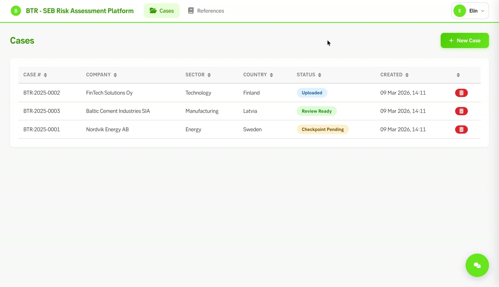
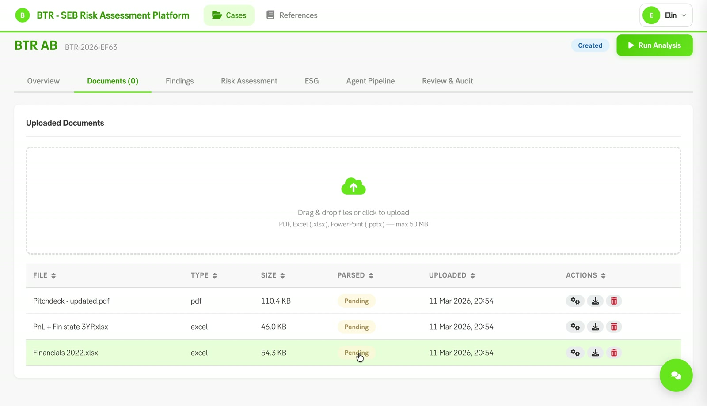
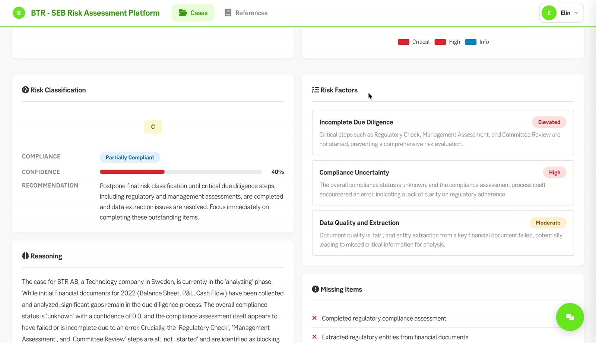
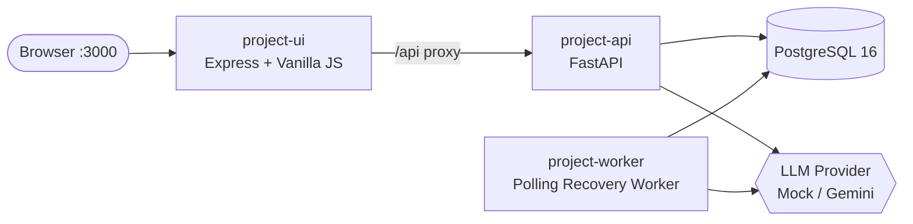
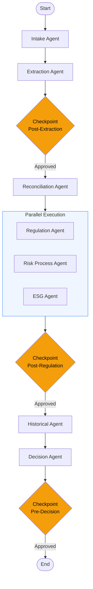

# BTR — Beat The Risk

[](https://github.com/cesarsotovalero/btr-project/actions/workflows/ci.yml)
[](LICENSE)
[](https://github.com/cesarsotovalero/btr-project/releases/tag/v0.1.0)

**Credit risk assessment, with human oversight.**

A team hackathon prototype that turns loan applications, financial statements, and ESG disclosures into findings an analyst can review. Eight specialist agents coordinate document analysis, risk assessment, and three human approval checkpoints.

[Watch the demo](docs/BTR%20-%20pitch.mp4) · [Quick start](#quick-start-docker) · [Visual walkthrough](#visual-walkthrough) · [v0.1.0 release](https://github.com/cesarsotovalero/btr-project/releases/tag/v0.1.0)



*Track synthetic credit cases, documents, and review progress in one analyst workspace.*

Built during a team hackathon at Skandinaviska Enskilda Banken (SEB), with César Soto Valero responsible for the primary application implementation. [Meet the team](docs/Team_BTR.png).

> **Prototype / synthetic data:** Seeded companies, historical outcomes, policy examples, and generated test documents are illustrative, not customer records or authoritative bank policies. This project does not establish regulatory compliance. Demo credentials and the development signing key are for local demonstration only.

## Visual walkthrough

These screenshots are captured from the retained hackathon demo video. The recorded session may differ from a fresh seeded installation.

1. **Choose a case.** Review the case list above and open a borrower to inspect its documents and workflow status.
2. **Collect and analyze documents.** Upload source files, parse their contents, and start the agent pipeline.

   

3. **Review the findings.** Inspect risk factors and supporting reasoning; approve or reject the pipeline at its human checkpoints.

   

For the complete flow, [watch the two-minute demo](docs/BTR%20-%20pitch.mp4).

## Table of Contents

- [BTR — Beat The Risk](#btr--beat-the-risk)
  - [Visual walkthrough](#visual-walkthrough)
  - [Table of Contents](#table-of-contents)
  - [Architecture](#architecture)
  - [Agent Pipeline](#agent-pipeline)
  - [Tech Stack](#tech-stack)
  - [Getting Started](#getting-started)
    - [Prerequisites](#prerequisites)
    - [Quick Start (Docker)](#quick-start-docker)
    - [Local Development](#local-development)
  - [Development](#development)
    - [Adding Components](#adding-components)
    - [Environment Variables](#environment-variables)
  - [API](#api)
  - [Frontend](#frontend)
  - [Testing](#testing)
  - [CI / CD](#ci--cd)
  - [Test Data](#test-data)
  - [License](#license)

## Architecture



| Service            | Description                                                                        | Port   |
| ------------------ | ---------------------------------------------------------------------------------- | ------ |
| **project-api**    | FastAPI backend — REST endpoints, Pydantic schemas, Alembic migrations             | `8000` |
| **project-ui**     | Vanilla JS SPA — case management, risk workspace, audit trace                      | `3000` |
| **project-worker** | Polling recovery worker — resumes interrupted workflows (polls Postgres every 5 s) | —      |
| **PostgreSQL 16**  | Persistent storage — cases, documents, findings, checkpoints                       | `5433` |

Primary workflow execution is triggered by the API (`POST /api/cases/{id}/analyze`). The worker is a secondary path that picks up cases left in `analyzing` state after restarts.

## Agent Pipeline

The risk assessment pipeline processes uploaded documents through 8 specialized agents with 3 human-approval checkpoints:



| Agent              | Purpose                                                              |
| ------------------ | -------------------------------------------------------------------- |
| **Intake**         | Validates case metadata and document completeness                    |
| **Extraction**     | Parses PDFs and Excel files, extracts financial metrics and entities |
| **Reconciliation** | Cross-checks figures across documents, flags inconsistencies         |
| **Regulation**     | Checks compliance against EU regulations (Taxonomy, ETS, CSRD, PSD2) |
| **Risk Process**   | Evaluates adherence to internal risk assessment procedures           |
| **ESG**            | Assesses environmental, social, and governance risk factors          |
| **Historical**     | Finds and compares similar past cases                                |
| **Decision**       | Synthesizes all findings into a final risk rating                    |

Checkpoints pause the pipeline for human review. This prototype does not establish GDPR or EU AI Act compliance.

## Tech Stack

| Layer            | Technology                                             |
| ---------------- | ------------------------------------------------------ |
| Language         | Python 3.13                                            |
| API Framework    | FastAPI + Pydantic v2                                  |
| ORM              | SQLAlchemy 2.0 (async)                                 |
| Database         | PostgreSQL 16                                          |
| Migrations       | Alembic (5 migrations)                                 |
| Auth             | bcrypt + PyJWT (OAuth2 bearer tokens)                  |
| LLM              | MockProvider (default) / Gemini via Vertex AI          |
| Document Parsing | pypdf, openpyxl, python-pptx, csv (stdlib)             |
| Frontend         | Vanilla JS SPA + Express proxy                         |
| UI Components    | SEB Green Design System (`@sebgroup/green-core` v2.37) |
| Icons            | Font Awesome 6.5.1 (CDN)                               |
| Charts           | Apache ECharts v6 (custom SEB theme)                   |
| Package Manager  | uv (Python) · npm (UI)                                 |
| Linting          | Ruff (rules: E F I N W UP)                             |
| CI               | GitHub Actions (lint, test, Docker build)              |
| Containerization | Docker Compose                                         |

## Getting Started

### Prerequisites

- [uv](https://github.com/astral-sh/uv) — Python package manager
- [Docker](https://www.docker.com/) & Docker Compose
- [Node.js](https://nodejs.org/) (for UI development)

### Quick Start (Docker)

```bash
# Create .env from the example and fill in your POSTGRES_PASSWORD
cp .env.example .env
# Edit .env and set POSTGRES_PASSWORD to a value of your choice

# Start all services (build + run)
make docker-up
```

Open [http://localhost:3000](http://localhost:3000) in your browser.
Default credentials: `analyst` / `analyst123`.

> Docker Compose defaults `LLM_BACKEND` to `gemini`. Add `LLM_BACKEND=mock` to `.env` to run without Vertex AI credentials.

### Local Development

Requires Docker (for Postgres), [uv](https://github.com/astral-sh/uv), and Node.js.

```bash
# One command — starts Postgres, runs migrations, seeds data, launches API + UI
make dev
```

Or step by step:

```bash
# 1. Install Python dependencies
cd project-api && uv sync && cd ..

# 2. Start Postgres and prepare the database
make db-up db-wait db-migrate db-seed

# 3. Start API + UI in separate terminals
make dev-api    # terminal 1 — FastAPI on :8000
make dev-ui     # terminal 2 — Express on :3000
```

`make dev-api` automatically stops `btr-project-worker-1` if it is running, to
avoid duplicate workflow execution against the same local database.

Environment overrides can be placed in `.env.local` (git-ignored). See `.env.example` for available variables.

**Windows users:** Use `.\make.ps1 <target>` instead of `make` (PowerShell equivalent with the same targets).

## Development

```bash
# Lint and format
make lint           # check only
make format         # auto-fix

# Create a new Alembic migration
cd project-api && PYTHONPATH=src uv run alembic revision --autogenerate -m "description"

# Database lifecycle
make db-reset       # drop + re-migrate + re-seed
make db-migrate     # run pending migrations
make db-seed        # seed sample data (idempotent)

# Docker logs
make docker-logs
```

### Adding Components

| What               | Steps                                                                                          |
| ------------------ | ---------------------------------------------------------------------------------------------- |
| **New agent**      | Create `app/agents/<name>_agent.py`, register in `workflow.py` `AGENT_NAMES`                   |
| **New model**      | Create `app/models/<name>.py`, export in `app/models/__init__.py`, create migration            |
| **New API route**  | Create/extend router in `app/api/`, register in `main.py` if new file                          |
| **New LLM method** | Add abstract method to `llm/base.py`, implement in `mock_provider.py` and `gemini_provider.py` |
| **New parser**     | Add to `app/parsers/`, register allowed extension in `app/api/documents.py`                    |

### Environment Variables

| Variable                         | Default                                                      | Description                                       |
| -------------------------------- | ------------------------------------------------------------ | ------------------------------------------------- |
| `DATABASE_URL`                   | `postgresql+asyncpg://btr:<pw>@db:5432/btr`                  | Async database connection string                  |
| `DATABASE_URL_SYNC`              | `postgresql://btr:<pw>@db:5432/btr`                          | Sync connection for Alembic migrations            |
| `POSTGRES_PASSWORD`              | _(required)_                                                 | Database password — set in `.env` or `.env.local` |
| `LLM_BACKEND`                    | `mock` (app) / `gemini` (Docker Compose & Makefile)          | LLM provider: `mock` or `gemini`                  |
| `UPLOAD_DIR`                     | `/app/uploads` (Docker) / `./uploads` (local)                | Document upload directory                         |
| `API_URL`                        | `http://project-api:8000` (Docker) / `http://localhost:8000` | Backend URL for UI proxy                          |
| `VERTEX_AI_PROJECT`              | —                                                            | GCP project ID for Gemini                         |
| `VERTEX_AI_LOCATION`             | `europe-west1`                                               | GCP region for Vertex AI                          |
| `GOOGLE_APPLICATION_CREDENTIALS` | `~/.config/gcloud/application_default_credentials.json`      | ADC file path (local dev with Gemini)             |
| `SECRET_KEY`                     | `btr-dev-secret-change-in-production`                        | JWT signing key — **must** override in production |
| `JWT_ALGORITHM`                  | `HS256`                                                      | JWT signing algorithm                             |
| `ACCESS_TOKEN_EXPIRE_MINUTES`    | `480`                                                        | Token TTL (8-hour analyst shift)                  |
| `APP_NAME`                       | `BTR Risk Assessment`                                        | Application display name                          |
| `DEBUG`                          | `false`                                                      | FastAPI debug mode                                |

## API

7 routers registered under the `/api` prefix, plus a root `GET /health` endpoint.

| Router         | Prefix                                      | Key Endpoints                                                                     |
| -------------- | ------------------------------------------- | --------------------------------------------------------------------------------- |
| **Auth**       | `/api/auth`                                 | `POST /register`, `POST /login`, `GET /profile`, `PUT /profile`                   |
| **Cases**      | `/api/cases`                                | CRUD — `POST /`, `GET /`, `GET /{id}`, `PUT /{id}`, `DELETE /{id}`                |
| **Documents**  | `/api/cases/{id}/documents`                 | Upload, list, parse, extract, download, delete                                    |
| **Analysis**   | `/api/cases/{id}`                           | `POST /analyze`, `GET /findings`, `GET /risk-assessment`, checkpoints, agent runs |
| **Chat**       | `/api/cases/{id}/chat`                      | `POST /` — context-aware AI Q&A with sources                                      |
| **Reviews**    | `/api/cases/{id}/review`                    | `POST /` (submit review), `GET /audit-log`                                        |
| **References** | `/api/regulations`, `/api/historical-cases` | Manage regulation sources and historical case references                          |

14 ORM models: `Case`, `Document`, `DocumentExtraction`, `CaseFinding`, `AgentRun`, `WorkflowCheckpoint`, `AnalystReview`, `AuditLog`, `RiskAssessment`, `EsgAssessment`, `EvidenceRef`, `HistoricalCase`, `RegulationSource`, `User`.

## Frontend

Vanilla JS SPA with no framework dependencies. Express serves static files and proxies `/api` to the backend.

**Pages** (in `project-ui/public/js/pages/`):

| Page                  | Route                   | Description                       |
| --------------------- | ----------------------- | --------------------------------- |
| Login                 | `/login`                | Authentication                    |
| Case List             | `/cases`                | Case overview and management      |
| Case Detail           | `/cases/:id`            | Case deep dive                    |
| Document Intelligence | `/cases/:id/documents`  | Document parsing and extraction   |
| Compliance Dashboard  | `/cases/:id/compliance` | Regulatory compliance view        |
| Risk Workspace        | `/cases/:id/risk`       | Analyst risk assessment workspace |
| Audit Trace           | `/cases/:id/audit`      | Full audit trail                  |

**Analyst ChatBot** — floating side panel on case pages (`chat.js`) calls `POST /api/cases/{id}/chat` for context-aware AI assistance.

**Build:** `cd project-ui && npm run build` regenerates `green.bundle.js` (SEB Green components) and `echarts.bundle.js` (ECharts with SEB theme).

## Testing

```bash
make test                                      # run all tests (114 tests)
cd project-api && uv run pytest -v             # verbose output
cd project-api && uv run pytest -k test_name   # run specific test
```

14 test files across auth, cases, chat, checkpoints, documents, ESG, findings, LLM providers, parsers, reconciliation, references, and workflow.

Tests run against an in-memory SQLite database — no external services required.

## CI / CD

GitHub Actions CI runs on every push and PR to `main` with three jobs:

| Job               | Runner                      | What it does                                              |
| ----------------- | --------------------------- | --------------------------------------------------------- |
| **Lint & Format** | ubuntu-latest               | `ruff check` + `ruff format --check` on `src/` and tests  |
| **Tests**         | ubuntu-latest + Postgres 16 | `pytest` with coverage → Codecov upload                   |
| **Docker Build**  | ubuntu-latest               | Builds API and UI images (no push), validates Dockerfiles |

## Test Data

Three sample cases with realistic fake documents (PDFs + Excel) are provided for testing the full pipeline:

| Case                         | Sector        | Country | ESG | Documents                                                             |
| ---------------------------- | ------------- | ------- | --- | --------------------------------------------------------------------- |
| Nordvik Energy AB            | Energy        | Sweden  | Yes | Annual Report, Financial Statements, Loan Application, ESG Disclosure |
| FinTech Solutions Oy         | Technology    | Finland | No  | Annual Report, Financial Statements, Credit Application               |
| Baltic Cement Industries SIA | Manufacturing | Latvia  | Yes | Annual Report, Financial Statements, Loan Application, ESG Disclosure |

Regenerate: `cd project-api && uv run python data/generate_test_data.py`

See [`project-api/data/test_documents/README.md`](project-api/data/test_documents/README.md) for full details and planted inconsistencies.

## License

Application source is available under the [MIT License](LICENSE), copyright © 2026 César Soto Valero. Third-party software, fonts, branding, and media retain their respective rights; see [THIRD_PARTY_NOTICES.md](THIRD_PARTY_NOTICES.md).
